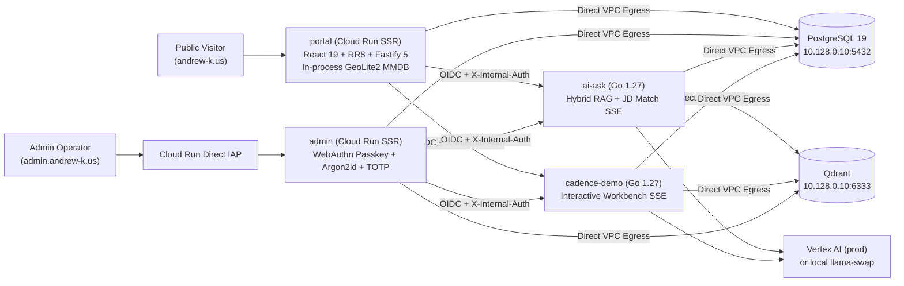

# andrew-k.us (`aklapper`)

Personal engineering portfolio, interactive AI career assistant, live specification-to-sandbox workbench, and Direct-IAP admin console for [andrew-k.us](https://andrew-k.us).

Built as a polyglot **Nx 24** monorepo combining **React 19 / React Router 8 Streaming SSR** (Node 26 + Fastify 5), **Go 1.27** AI and sandbox microservices, **PostgreSQL 19** (Drizzle ORM), and **Qdrant** vector search, deployed on a scale-to-zero **Google Cloud Run** stack.

---

## Architecture



---

## Key Capabilities

- **Zero-Await Streaming SSR & Enterprise Error Handling:** Fastify 5 pipes React Router 8 `ReadableStream` responses directly (`X-Accel-Buffering: no`, `X-Correlation-Id`, client-disconnect `AbortController` propagation). Deferred server queries settle into wire-safe `StreamResult<T>` envelopes rendered via `<SuspenseElement<T>>`, paired with structured Pino diagnostics and deduplicated client error telemetry.
- **Interactive Terminal & Multi-Pane Desktop Workspace:** Global desktop `TerminalWorkspace` (`@aklapper/ui`) with split panes, closable tabs, keyboard shortcuts, and unified route/pane views for `/about`, `/chat`, `/agensi`, `/cadence`, and `/contact`, plus a responsive mobile host.
- **Ask Portfolio & JD Match (`/chat` + `ai-ask`):** Hybrid PostgreSQL + Qdrant retrieval with SSE streaming, durable `ask_turns` reload recovery (15-minute recovery TTL, 90-day terminal analytics retention), atomic guest quota locking, and privacy-redacted JD Match evaluation.
- **Interactive Workbench (`/cadence` + `cadence-demo`):** Preset and custom prompts streamed via two-phase durable SSE into a fail-closed HTML5 `srcdoc` sandbox with SHA-256 CSP script pinning.
- **Cookieless Visitor Analytics & Contact Linking (`/analytics` + `/inbox`):** Strictly cookieless and browser-storage-free passive portal analytics with non-blocking SSR hit capture, in-process MaxMind GeoLite2 City + ASN lookups (`$0/mo`, graceful `null` fallback), daily-salted `visitor_hash` 30-minute sessions serialized via `pg_advisory_xact_lock`, referrer and `?ref=`/`utm_*` attribution, and verified `/contact` linking via normalized query-time joins (deleting a submission in `/inbox` immediately removes PII from `/analytics`).
- **Admin Console (`admin.andrew-k.us`):** Protected by Cloud Run Direct IAP plus Layer-2 WebAuthn passkeys (`@simplewebauthn/server`), native Node Argon2id passwords, and zero-dependency SVG TOTP 2FA. Includes structured CMS editors with live desktop/mobile preview and fail-closed PII sanitization, URL-filterable visitor analytics, contact inbox with visitor context strips, guest quota controls, and live Qdrant/service ops health.

---

## Workspace Layout

| Path                                | Package / Project                           | Purpose                                                                                                                                                   |
| ----------------------------------- | ------------------------------------------- | --------------------------------------------------------------------------------------------------------------------------------------------------------- |
| `apps/portal/portal`                | `portal` (`@aklapper/portal`)               | Public SSR site (`andrew-k.us`): `/`, `/about`, `/chat`, `/cadence`, `/agensi`, `/contact`, and BFF API routes                                            |
| `apps/admin/admin`                  | `admin` (`@aklapper/admin`)                 | Authenticated Admin SSR console (`admin.andrew-k.us`): `/`, `/login`, `/analytics`, `/cms`, `/inbox`, `/quotas`, `/ops`                                   |
| `apps/portal/portal-e2e`            | `portal-e2e`                                | Playwright E2E suite (`chromium`, `firefox`, `webkit`, `mobile-chrome`)                                                                                   |
| `apps/admin/admin-e2e`              | `admin-e2e`                                 | Playwright E2E suite (`chromium`, `firefox`, `webkit`, `mobile-chrome`)                                                                                   |
| `apis/go/ai-ask/ai-ask`             | `go-ai-ask` (+ `go-ai-ask-e2e`)             | Go 1.27 RAG Q&A and JD Match streaming API                                                                                                                |
| `apis/go/cadence-demo/cadence-demo` | `go-cadence-demo` (+ `go-cadence-demo-e2e`) | Go 1.27 interactive specification and sandbox workbench API                                                                                               |
| `packages/shared/core`              | `shared-core` (`@aklapper/core`)            | Browser-safe Zod schemas, typed route unions, `PublicAppError` catalog, cookieless analytics client, and client error reporter                            |
| `packages/shared/ui`                | `shared-ui` (`@aklapper/ui`)                | 4-layer CSS Modules UI library (`@layer tokens, element, component, page;`), `<SuspenseElement>`, `TerminalWorkspace`, `ZshP10kTerminal`, and `QrCodeSvg` |
| `packages/node/runtime`             | `node-runtime` (`@aklapper/node-runtime`)   | Fastify SSR edge server, stream helpers, Argon2id/TOTP/HMAC auth, Cloud Run OIDC, privacy scanner, Agensi client, and GeoLite2 MMDB reader                |
| `packages/node/db`                  | `node-db` (`@aklapper/db`)                  | Drizzle ORM schema, reversible SQL migrations (`drizzle/0000..0010`), transactional seeders, and portal/admin/analytics queries                           |
| `packages/go/kit`                   | `go-kit`                                    | Shared Go contracts, PostgreSQL 19 store, Qdrant UUIDv5 seeder, LLM clients (Vertex AI & local), privacy redaction, and HTTP internal-auth middleware     |
| `packages/tooling`                  | `tooling` (`@aklapper/tooling`)             | Vite/Playwright configs, ephemeral PG19 test runner, Nx CI planner (`ci-plan.ts`), Git hooks runner (`git-hooks.ts`), and GitHub/GCP env sync CLI         |
| `packages/legacy/games-engine`      | `legacy-games`                              | Legacy game engine workspace library                                                                                                                      |
| `infra/docker`                      | Docker Compose                              | Local dev (`docker-compose.dev.yaml`) and single-VM production stateful layout (`docker-compose.prod.yaml`)                                               |

---

## Tech Stack

- **Runtime & Tooling:** Node `26.13.1`, pnpm `12.23.0`, Nx `24.0.6`, Go `1.27.4`, TypeScript (`tsc7` native compiler), strict ESM (`"type": "module"`)
- **Frontend & SSR:** React `19.3`, React Router `8.5` (Streaming SSR + typed `+types/*` routes), Fastify `5.12`, Base UI, 4-layer OKLCH CSS Modules
- **Data & Search:** PostgreSQL 19 + Drizzle ORM `0.45`, Qdrant vector database, MaxMind GeoLite2 City + ASN (`maxmind` pure JS)
- **Formatting, Linting & Testing:** `oxfmt`, `oxlint` (`typescript/no-explicit-any`), Vitest `5.1`, `go test`, Playwright (Desktop Chrome/Firefox/Safari + Mobile Chrome `Pixel 7`)

---

## Local Development

### Prerequisites

- Node `26.13.1`, pnpm `12.23.0`, Go `1.27+`, and Docker (for local PostgreSQL 19, Qdrant, and ephemeral DB tests).

### 1. Install Dependencies & Wire Git Hooks

```bash
pnpm install
```

`pnpm install` runs `pnpm prepare`, activating native Git hooks in `.githooks/` (`core.hooksPath=.githooks`):

- **`.githooks/pre-commit`** (`pnpm hooks:pre-commit`): blocks direct commits to `main` and `develop`, runs `pnpm format` (re-staging fully staged files safely without sweeping unstaged hunks), and runs `pnpm affected:check --stdin` (`nx affected -t lint typecheck`) strictly on affected projects.
- **`.githooks/pre-push`** (`pnpm hooks:pre-push`): blocks direct pushes to `refs/heads/main`.

### 2. Configure Environment & Start Local Stateful Services

```bash
cp .env.example .env
docker compose -f infra/docker/docker-compose.dev.yaml up -d
pnpm db:setup
```

`pnpm db:setup` applies Drizzle migrations and seeds local PostgreSQL 19 (port `5439`). To index portfolio dossiers into local Qdrant (port `6333`), run:

```bash
pnpm qdrant:seed
```

_(Optional for local GeoLite2 testing: place `GeoLite2-City.mmdb` and `GeoLite2-ASN.mmdb` in `apps/portal/portal/data/geolite2/` or set `GEOLITE2_DB_DIR` in `.env`. Without them, geo/ASN lookups degrade cleanly to `null`.)_

### 3. Run Apps & Services Locally

```bash
# Public Portal SSR (default http://localhost:4300)
pnpm exec nx run portal:dev

# Admin Console SSR (default http://localhost:4301)
pnpm exec nx run admin:dev

# Go microservices (optional for live /chat and /cadence streaming)
pnpm exec nx run go-ai-ask:serve
pnpm exec nx run go-cadence-demo:serve
```

### 4. Common Workspace Commands

| Command                                    | Description                                                                             |
| ------------------------------------------ | --------------------------------------------------------------------------------------- |
| `pnpm format` / `pnpm format:check`        | Format or verify formatting across the workspace with `oxfmt`                           |
| `pnpm lint`                                | Run `oxlint` and Go lint across all projects                                            |
| `pnpm typecheck`                           | Run `tsc7` typechecking across all TypeScript projects                                  |
| `pnpm affected:check`                      | Run `lint` and `typecheck` only on Nx-affected projects                                 |
| `pnpm build`                               | Build all libraries, SSR apps, and Go binaries                                          |
| `pnpm test`                                | Spin up an ephemeral tmpfs PostgreSQL 19 container and run all unit & integration tests |
| `pnpm e2e`                                 | Run Playwright and Go API E2E suites against ephemeral PostgreSQL 19                    |
| `pnpm db:migrate` / `pnpm db:seed`         | Run Drizzle migrations or seed PostgreSQL 19                                            |
| `pnpm qdrant:dry-run` / `pnpm qdrant:seed` | Preview or sync UUIDv5 Qdrant corpus vectors                                            |
| `pnpm gh:sync-env --dry-run`               | Preview syncing `.env.gcp.production.local` to GitHub Environment & GCP Secret Manager  |

---

## CI/CD & Production Deployment

- **Pull Request CI (`.github/workflows/ci.yml`):** Triggers on pull requests targeting `main` (and `workflow_dispatch`). Runs `oxfmt --check`, computes the Nx affected graph (`ci-plan.ts`), and executes affected `lint`, `typecheck`, `build`, ephemeral PG19 unit/integration tests, Go API E2E, 4-browser Playwright E2E (`chromium`, `mobile-chrome`, `firefox`, `webkit`), and Docker Buildx validation behind the required **`CI status gate`**.
- **Production Deploy (`.github/workflows/cd-gcp.yml`):** Triggers on pushes to `main` (and `workflow_dispatch`) using keyless GCP Workload Identity Federation (WIF). Downloads and verifies optional MaxMind GeoLite2 City + ASN `.mmdb` databases (`MAXMIND_ACCOUNT_ID` / `MAXMIND_LICENSE_KEY`, cached weekly via `actions/cache@v6`), builds and pushes immutable `github.sha` container images to Artifact Registry, runs `aklapper-db-migrate`, rolls out Wave 1 Go APIs (`ai-ask`, `cadence-demo`) followed by Wave 2 SSR services (`portal`, `admin`), and verifies Direct IAP edge protection, WIF `/health`, and live Playwright `@smoke` checks against `https://andrew-k.us`.
- **Branch Sync (`.github/workflows/sync-develop.yml`):** Automatically fast-forwards `develop` from `main` after release merges so `develop` stays in lockstep with `main`.

---

## License

Private portfolio source repository. All rights reserved.
